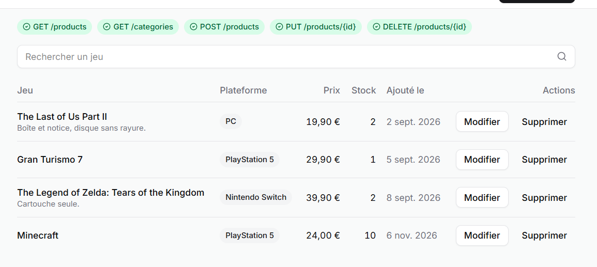
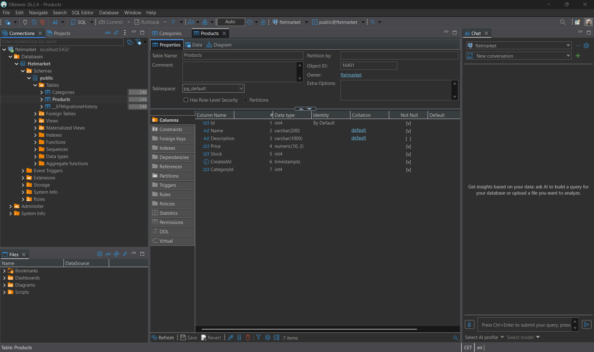
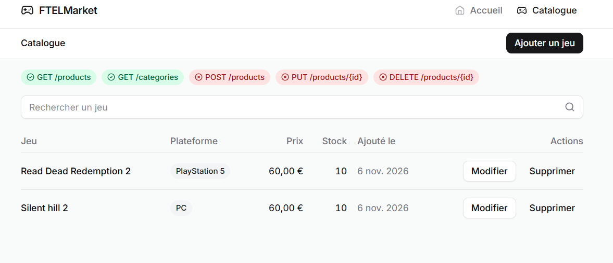
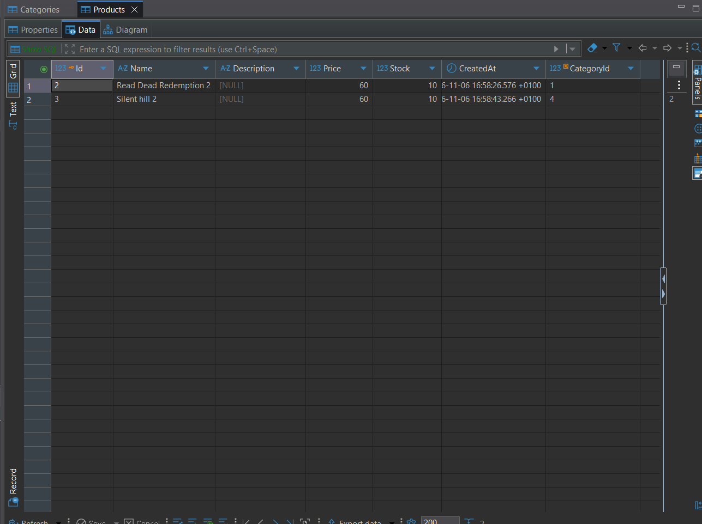

# Compte rendu - TP Installation et CRUD
**Étudiant :** Anas SAADI
---

## 1. Introduction

Le but de ce TP était de créer une API en C# à partir du modèle de Microsoft, puis de la brancher sur le front FTELMarket fourni.

Le TP s'est fait en deux temps :
- d'abord un CRUD avec des données en dur dans le controller,
- ensuite la connexion à une vraie base de données avec Entity Framework Core, pour que les données soient conservées après un redémarrage.

Outils utilisés : Visual Studio 2026, .NET 10, Docker Desktop, PostgreSQL et DBeaver.

---

## 2. Installation et création du projet

J'ai installé la charge de travail "Développement web et ASP.NET" dans Visual Studio, ce qui installe aussi le SDK .NET 10. Docker Desktop et DBeaver étaient à installer à part.

J'ai ensuite créé un projet **ASP.NET Core Web API** en cochant "Use controllers" et "Enable OpenAPI support". L'option "Use controllers" est importante, sinon le fichier `WeatherForecastController.cs` dont parle le sujet n'est pas généré.

### Rôle des fichiers

**Question : quel est le rôle de Program.cs, appsettings.json et launchSettings.json ?**

- **Program.cs** : c'est le point d'entrée de l'application. On y enregistre les services dont l'appli a besoin (controllers, base de données, CORS...), puis on configure ce qui se passe à chaque requête HTTP.
- **appsettings.json** : c'est le fichier de configuration. On y met par exemple le niveau des logs ou la chaîne de connexion à la base de données.
- **launchSettings.json** : il ne sert qu'en développement. Il indique comment lancer l'appli depuis Visual Studio : sur quels ports, dans quel environnement, et s'il faut ouvrir le navigateur.

### Premier lancement

Au lancement avec F5, aucun navigateur ne s'est ouvert. J'ai compris que depuis .NET 9 le modèle n'inclut plus Swagger, donc il n'y a pas de page à ouvrir (`launchBrowser` est à `false`). Il faut taper l'adresse soi-même.

La route `https://localhost:7249/weatherforecast` renvoie bien les prévisions météo (des données aléatoires) en JSON.

---

## 3. Création des routes du catalogue

### Les routes attendues

Pour savoir ce qu'attend le front, j'ai regardé son code, en particulier `api-contract.ts` et `schemas.ts`. Il appelle 6 routes :

| Méthode | Route | Rôle | Réponse |
|---|---|---|---|
| GET | /api/products | lister les produits | 200 |
| GET | /api/products/{id} | voir un produit | 200 ou 404 |
| POST | /api/products | créer un produit | 201 |
| PUT | /api/products/{id} | modifier un produit | 200 ou 404 |
| DELETE | /api/products/{id} | supprimer un produit | 204 ou 404 |
| GET | /api/categories | lister les catégories | 200 |

J'ai créé deux controllers, `ProductsController` et `CategoriesController`, qui héritent de `ControllerBase`. Comme demandé, les modèles de réponse sont dans le controller et les données sont en dur dans une liste.

J'ai aussi ajouté des règles de validation sur les champs, les mêmes que celles du front : nom obligatoire (200 caractères max), prix entre 0,01 et 1 000 000, stock positif ou nul, catégorie obligatoire. Les messages d'erreur sont en français.

### Problèmes rencontrés

Plusieurs choses empêchaient le front de communiquer avec l'API :

- **Les ports** : le front appelle l'API sur `localhost:5082`, alors que mon projet avait été créé sur d'autres ports. Je les ai changés dans `launchSettings.json`.
- **Le CORS** : le front tourne sur `localhost:3000`, donc sur une autre origine que l'API. Le navigateur bloque les appels si l'API n'autorise pas cette origine. J'ai ajouté une règle CORS dans `Program.cs`.
- **La redirection HTTPS** : le front appelle l'API en http, et la redirection automatique vers https cassait les appels. Je l'ai retirée.
- **Les noms des champs en erreur** : quand la validation échoue, .NET renvoyait les noms en PascalCase (`Name`) alors que le front attend du camelCase (`name`). Sans ça, les erreurs ne s'affichaient pas sous le bon champ. J'ai réglé ça dans `Program.cs`.

### Résultat

Depuis le front, on peut consulter le catalogue, ajouter, modifier et supprimer un jeu. Les 5 badges passent au vert :



---

## 4. Connexion à la base de données

### Choix de la base

Le sujet laissait le choix entre SQL Server et PostgreSQL. J'ai pris **PostgreSQL**, parce qu'il est plus léger à faire tourner dans Docker. Le `docker-compose.yml` du front contenait déjà un service PostgreSQL en commentaire, je l'ai simplement décommenté.

### Packages installés

- Microsoft.EntityFrameworkCore 10.0.11
- Microsoft.EntityFrameworkCore.Design 10.0.11
- Npgsql.EntityFrameworkCore.PostgreSQL 10.0.3
- Microsoft.EntityFrameworkCore.Tools 10.0.11

Le dernier n'est pas dans la notice, mais j'en ai eu besoin : sans lui, la commande `Add-Migration` n'est pas reconnue dans la console de Visual Studio.

### Modèle de données

À partir de la description du métier, j'ai créé deux entités :

- **Product** : Id, Name, Description (facultative), Price, Stock, CreatedAt et CategoryId
- **Category** : Id, Name, et la liste de ses produits

Un produit est rangé dans une seule catégorie, et une catégorie regroupe plusieurs produits. C'est donc une relation **un-à-plusieurs**. J'ai empêché la suppression d'une catégorie qui contient encore des produits.

Les tables sont configurées en **fluent API**, avec une classe de configuration par entité, comme dans la notice. Tout ce qui concerne la base est rangé dans un dossier `Data`.

Les 4 catégories (PlayStation 5, Nintendo Switch, Xbox Series X, PC) sont ajoutées directement par la migration, car le front ne permet pas d'en créer.

Je n'ai pas créé d'entité Utilisateur. Le métier dit que chaque utilisateur a son catalogue, mais le front ne gère pas encore d'utilisateurs, donc je l'ai laissée de côté pour l'instant.

### Questions du sujet

**Question : pour le prix, decimal, double ou float ?**

J'ai choisi `decimal`. Les types `double` et `float` stockent les nombres en binaire, et beaucoup de nombres décimaux ne peuvent pas y être représentés exactement. Par exemple, `0.1 + 0.2` donne `0.30000000000000004` en `double`. Sur des prix, ces petites erreurs finissent par fausser les totaux. Le type `decimal` est fait pour ça : il garde les valeurs exactes. En base, la colonne est un `numeric(10,2)`.

**Question : comment gérer les dates si l'application est utilisée sur plusieurs fuseaux horaires ?**

J'enregistre toutes les dates en **UTC** (avec `DateTime.UtcNow`). Comme ça, tout le monde a la même référence, quel que soit son pays. C'est ensuite le front qui convertit l'heure dans le fuseau de l'utilisateur pour l'affichage. En base, la colonne est de type `timestamp with time zone`.

---

## 5. Migrations

J'ai créé puis appliqué la migration avec ces commandes dans la Console du Gestionnaire de package :

```
Add-Migration InitialCreate
Update-Database
```

Au moment du `Update-Database`, un message rouge `fail` est apparu. En le lisant, j'ai vu qu'EF essayait de lire la table `__EFMigrationsHistory` avant qu'elle existe. C'est normal la première fois, et la migration s'est bien terminée (`Done.`).

J'ai vérifié dans DBeaver que les tables étaient bien créées, avec les bons types de colonnes :



---

## 6. Du navigateur à la base de données

Pour finir, j'ai remplacé les listes en dur des controllers par des appels à la base. Les controllers reçoivent le `FtelMarketDbContext` par injection de dépendance et l'utilisent pour lire, ajouter, modifier et supprimer les produits.

J'ai ajouté des jeux depuis le front puis redémarré l'API : les jeux sont toujours là.



On retrouve les mêmes données dans la table `Products` :



Sur la capture du front, les badges POST, PUT et DELETE sont rouges uniquement parce que la page venait d'être rechargée. Le front ne les passe au vert qu'après avoir fait l'action une fois.
